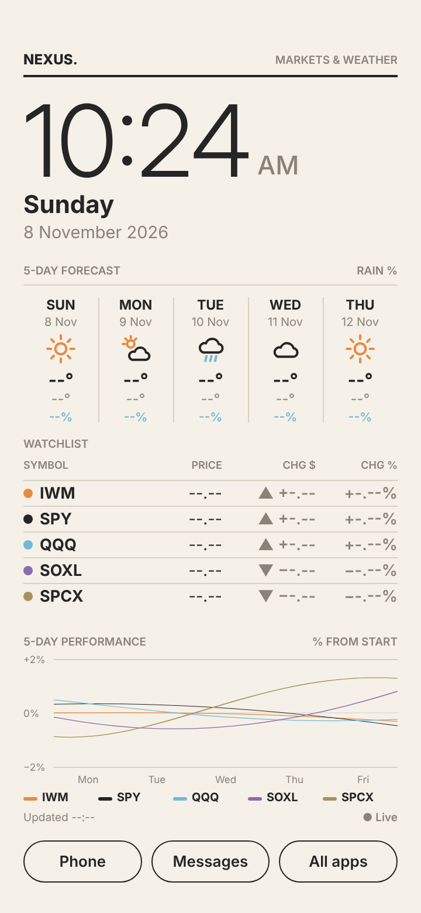

# NEXUS — KLWP Market & Weather Dashboard

A simple, bright live wallpaper for a Samsung Galaxy S22 (KLWP + Tasker + Nova):
clock, 5-day weather, a 5-stock watchlist (IWM, SPY, QQQ, SOXL, SPCX), a combined 5-day % chart,
and Phone / Messages / All apps buttons.



*Desktop layout preview with placeholders. The chart lines are illustrative, not market data.*

## Files to put on the phone
| File | Install with |
|---|---|
| [`klwp/NEXUS.klwp`](klwp/NEXUS.klwp) | KLWP → Load preset → import |
| [`tasker/NEXUS.prj.xml`](tasker/NEXUS.prj.xml) | Tasker → long-press house icon → Import Project |

Step-by-step: **[docs/INSTALL.md](docs/INSTALL.md)** · Problems: **[docs/TROUBLESHOOTING.md](docs/TROUBLESHOOTING.md)** ·
Test list: **[docs/PHONE-CHECKLIST.md](docs/PHONE-CHECKLIST.md)** · Data setup: **[config/stocks.md](config/stocks.md)**

## Status
| Stage | What | Status |
|---|---|---|
| 1 | Design mockup | ✅ Approved |
| 2–3 | KLWP wallpaper: clock, weather, buttons | Built. **Not yet tested on the phone** |
| 4–5 | Tasker: prices + 5-day chart | Built. Logic passes 16 automated tests. **Not yet tested on the phone** |
| 6 | Testing on the S22 | Waiting |
| 7 | Final ZIP package | After Stage 6 |

Nothing is marked as working until it's confirmed on the phone.

## For maintainers
```
python3 klwp/build_preset.py      # -> klwp/NEXUS.klwp, klwp/preset.json, klwp/preview.html
python3 tasker/build_tasker.py    # -> tasker/NEXUS.prj.xml (embeds tasker/nexus.js)
node --test tasker/test/*.test.js # logic tests (real Twelve Data response fixtures)
```
Fonts: Inter (SIL OFL 1.1, see `klwp/fonts/OFL.txt`). No API key is stored anywhere in this repository.
