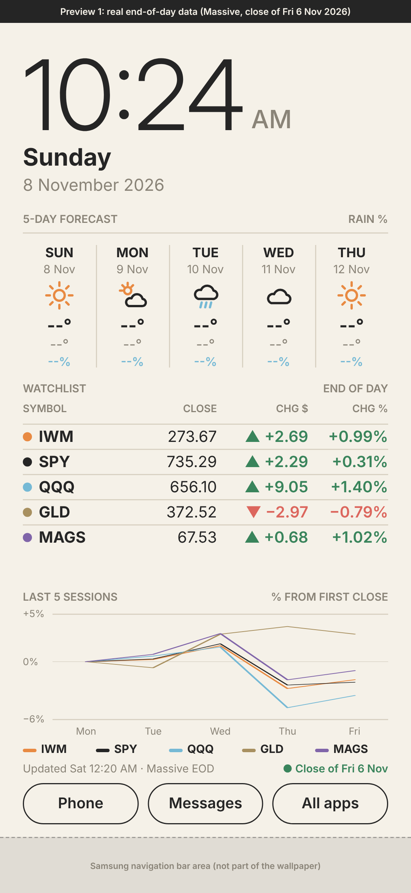
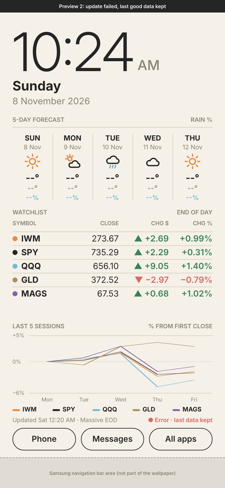
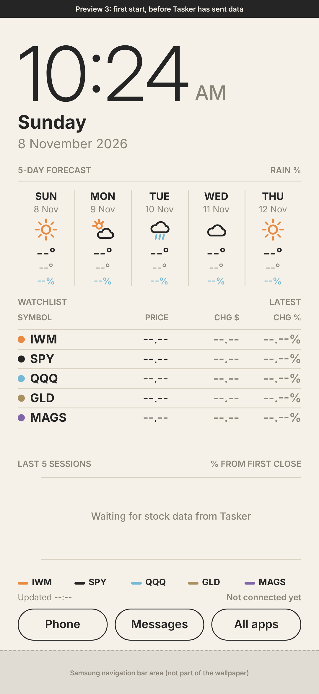

# NEXUS — KLWP Market & Weather Dashboard

A bright, simple live wallpaper for a Samsung Galaxy S22 (KLWP Pro + Tasker + Nova, 3 pages):
big clock and date, 5-day weather, five stocks (**IWM, SPY, QQQ, GLD, MAGS**) with daily $/% change,
one combined 5-session % chart (KLWP SVG Path shapes), and Phone / Messages / All apps buttons.

| Real data | Update failed | First start |
|---|---|---|
|  |  |  |

*Desktop previews at S22 size, made from the same element list as the preset. Preview 1 uses **real** Massive
end-of-day data (close of Fri 6 Nov 2026), processed by the real Tasker logic. Weather shows placeholders (it only
exists on the phone). The grey band marks Samsung's 3-button navigation bar. It's not part of the wallpaper.
**Not yet verified on the phone.***

## Files for the phone
| File | Install with |
|---|---|
| [`klwp/NEXUS.klwp`](klwp/NEXUS.klwp) | KLWP → Load preset → import |
| [`tasker/NEXUS.prj.xml`](tasker/NEXUS.prj.xml) | Tasker → long-press house icon → Import Project |

Guides: **[Install](docs/INSTALL.md)** · **[Data provider, key, credits & licensing](docs/DATA-PROVIDER.md)** ·
**[Troubleshooting](docs/TROUBLESHOOTING.md)** · **[Phone checklist](docs/PHONE-CHECKLIST.md)** · **[Data config](config/stocks.md)**

> ⚠️ **Licensing:** Twelve Data's free Basic plan is for *testing and development only, not display*.
> See [DATA-PROVIDER.md](docs/DATA-PROVIDER.md) before daily use.

## Status
| Item | Status |
|---|---|
| Symbols IWM SPY QQQ GLD MAGS | ✅ Checked on Twelve Data and Massive (8 Nov 2026) |
| Tasker logic (both providers, errors, credits) | ✅ 14 automated tests on real API responses |
| Layout: no title bar, buttons above the navigation bar | ✅ In the desktop preview · ⏳ **not yet checked on the S22** |
| KLWP preset + Tasker import on the phone | ⏳ **Not yet tested on the S22** |
| Twelve Data with a real (non-demo) key | ⏳ Not tested (no key used here) |

## For maintainers
```
TZ=America/New_York node tasker/make_sample.js   # real-data samples for the previews
python3 klwp/build_preset.py                     # -> klwp/NEXUS.klwp, preset.json, previews/*.png
python3 tasker/build_tasker.py                   # -> tasker/NEXUS.prj.xml (embeds tasker/nexus.js)
node --test tasker/test/*.test.js                # logic tests (real API fixtures)
```
Backups of earlier versions: `backup/`. Fonts: Inter (SIL OFL 1.1). No API key is stored in this repository.
